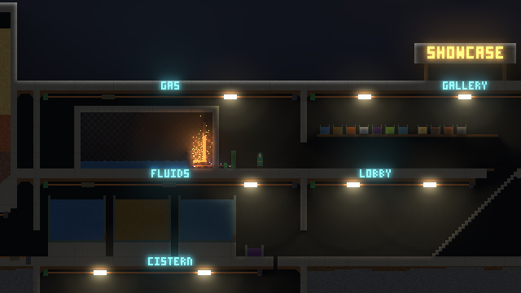
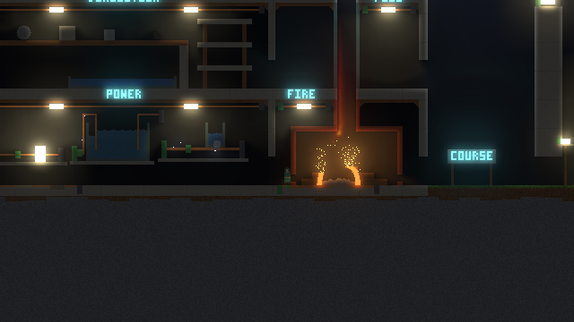
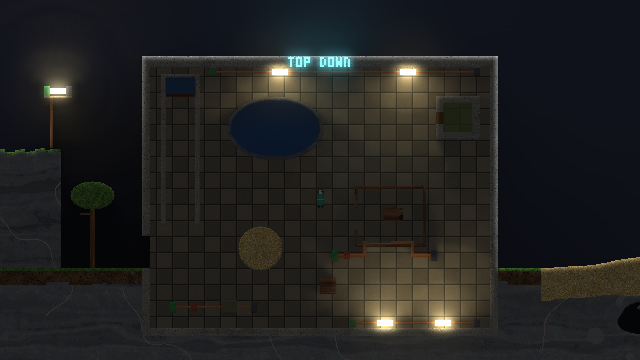
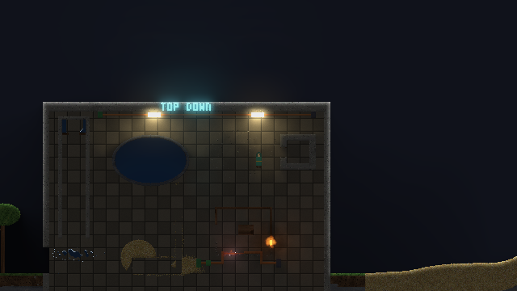

# Fine Grain

A 2D pixel sandbox where every grain is simulated: sand, water, fire, gas,
heat, bodies and electricity, all on one living pixel grid.

"notita" is still the repo, folder and build name (`notita.exe`,
`notita_world.sav`); "Fine Grain" is the name the game shows (window title,
title card, panels, the exe's version info).

Phase 1 is the engine core: a chunked, multithreaded falling-sand
simulation, data-driven materials, a GPU-presented 640x360 view and sandbox
brushes. Phase 2 adds per-pixel heat, state changes, fire and a reaction table
written in Luau. Phase 3 adds the gas grid: smoke, steam and other gases
flow on a velocity/pressure grid (GPU compute, with a CPU reference), with
buoyancy, convection, burning gas and explosions. Phase 4 adds splash
particles (liquids hit hard fly as momentum particles and settle back),
miscible liquids that blend, and rigid bodies: unsupported clumps of solid
pixels become Box2D bodies that fall, tumble and shatter. Phase 5 adds the
player: a 20 px capsule that walks, jumps, swims and glides through the
pixel world, digs material into an inventory and places it back, with a
creative mode and movement tools that all act through the sim (a jet that
puts real gas into the grid, a grapple, blast jumps, rafts that float by
density, freezing water to walk on). Phase 6 makes the world endless: a
procedural world (biomes, layered rock, caves, water tables, magma and gas
pockets) streamed by chunk around the player, with compressed, versioned
save files that carry every system's state, plus emissive-pixel lighting
with soft shadows and bloom on the GPU. The full plan lives in Corvid note N249.

## Build (Windows, MSVC)

Needs Visual Studio 2022 or newer with the C++ workload, and CMake 3.24+.
SDL3 3.4.20, Dear ImGui 1.93.0 and Luau 0.745 are downloaded by CMake
FetchContent on the first configure (hash-pinned).

```bat
build.bat
```

`build.bat` sets up the MSVC environment itself, uses Ninja if it is on PATH
and NMake otherwise, and builds Release into `build\`. Set
`NOTITA_BUILD_DIR` to build elsewhere. The first build compiles SDL3 and
takes a few minutes with NMake.

By hand, from an "x64 Native Tools" prompt:

```bat
cmake -S . -B build -G Ninja -DCMAKE_BUILD_TYPE=Release
cmake --build build
```

(The Visual Studio generator works too, but the "Visual Studio 18 2026"
generator needs CMake 4.2+.)

## Run

```bat
build\notita.exe                  :: the showcase building (default; same as --scene showcase)
build\notita.exe --scene demo     :: the old demo scene
build\notita.exe --scene forge    :: heat playground: magma, fire, etchant, frost
build\notita.exe --scene churn    :: whole world full of moving material
build\notita.exe --scene thermal  :: churn with hot and cold materials mixed in
build\notita.exe --scene gas      :: gas lab: boiling pot, chimney, hydrogen cave, heavy gas
build\notita.exe --scene quarry   :: phase 4: waterfall, blending liquids, blocks on a burning post, a boulder
build\notita.exe --scene play     :: phase 5: the player in a playground (hill, lake, rafts, cliff, updraft, quickmetal tub)
build\notita.exe --autoplay       :: the play scene with the player driven through a short demo
build\notita.exe --scene world    :: phase 6: the endless procedural world, streamed around the player
build\notita.exe --load notita_world.sav   :: open a saved world (F8 saves, F9 loads in the world scene)
build\notita.exe --scene world --autoplay  :: the player walks east digging (a streaming smoke run)
build\notita.exe --scene circuits          :: electricity: lamp, heater, brine tank, thermopile, plate, fuse, lightning mast
build\notita.exe --scene circuits --autoplay :: closes every switch and calls lightning (an electricity smoke run)
build\notita.exe --scene showcase --autoplay :: walks up to the gallery and the demolition hall, closes every switch in reach
build\notita.exe --scene showcase --at 600,0 --autoplay :: stands in the furnace room and closes the switches (room screenshots)
build\notita.exe --scene topdown  :: the showcase, starting in the TOP DOWN room (gravity into the screen)
build\notita.exe --scene topdown --autoplay :: drains the gutter, walks through the sand, blasts the crate, opens the murk tank
build\notita.exe --scene empty
build\notita.exe --gas-selftest   :: GPU gas solver vs the CPU reference, prints PASS/FAIL
build\notita.exe --light-selftest :: GPU light pass vs the CPU reference, prints PASS/FAIL
build\notita_tests.exe            :: unit tests (optional name filter as arg)
build\notita_bench.exe [ticks] [threads...]
```

Other flags: `--threads N`, `--seed N`, `--frames N --screenshot out.bmp`, `--electric-view current|potential`
(run N frames, save the sim view, quit: handy for smoke tests),
`--gas-cpu` (gas grid on the CPU solver), `--gas-view gas|velocity|pressure`,
`--light-cpu` (light pass on the CPU reference), `--no-light`, `--at x,y` (start with the
player's feet at x,y).

Controls:

| Input | Action |
| --- | --- |
| Left mouse | paint the selected material (fills empty/gas cells) |
| Shift + left mouse | paint, replacing anything |
| Right mouse | erase |
| Wheel, `[` `]` | brush size |
| `1`-`9` | pick material |
| Middle mouse drag, WASD / arrows (Shift = fast) | pan |
| Space | pause |
| `.` or `N` | step one tick (pauses) |
| Ctrl + left / right mouse | heat / cool under the brush |
| `H` / `J` / `P` | brush mode: heat / cool / paint |
| `R` / `F` / `B` / `C` | demo scene / forge scene / full churn scene / clear |
| F3 / Shift+F4 | chunk grid / dirty rects overlay |
| F4 | lighting on/off (Lighting panel: GPU/CPU, ambient, sky, gain, haze, bloom) |
| F5 | temperature view (hot pixels also glow in the normal view) |
| F10 | old / new look and motion: liquids as pixels and the phase 1 powder/liquid rules vs smooth liquids and smooth grains ("Look & motion" panel has each switch) |
| F11 | old / new flames: flame pixels vs flames as hot glowing gas on the gas grid ("Flames" panel has the knobs) |
| F12 | surface relief and wet look on solids and powders on / off ("Textures" panel has the strength sliders) |
| F6 | gas view: gas / velocity (hue = direction) / pressure (red +, blue -) |
| `G` / `X` / `V` | gas grid on/off / blast at the cursor (also kicks bodies) / gas lab scene |
| `Q` / `K` | quarry scene / cut the solid clump under the cursor loose as a rigid body |
| Tab or F1 | hide the panels |
| `L` / F7 | play scene with the player / spawn (or remove) a player at the cursor in any scene |
| F2 / `T` | creative mode on/off / slow motion |
| `O` | the streamed procedural world (World panel: window, sleeping chunks, mass, save/load) |
| `I` | the showcase building (the World panel names the room you're in) |
| F8 / F9 | save the world to `notita_world.sav` / load it (world and showcase scenes) |
| `U` | circuits scene (Electricity panel: live pixels, power, lamps, sparks, solver, tuning) |
| `E` | flip the switch under the cursor (with a player: the nearest one within tool reach, 56 px) |
| `Y` | lightning down the cursor's column |
| `M` | electricity overlay: current, then potential, then off |

With a player in the world the keys change (the Player panel lists them too):

| Input | Action |
| --- | --- |
| `A` `D` | walk (steps up ledges of 4 px) |
| `W` / Space | jump; swim up in liquid; reel the rope in; hold while falling to glide |
| `S` | swim down; let the rope out |
| `1`-`6` | tool: dig, jet, grapple, blast, raft, freeze |
| Left mouse | use the tool towards the cursor (within reach) |
| Right mouse | place the material in hand with the brush |
| Wheel (Shift+wheel = size) | material in hand; `[` `]` brush size |
| `Z` | placed solids fixed (scene geometry) or loose (they can fall as bodies) |
| `P` | pause (Space jumps) |

## Layout

```
src/sim/      simulation core, no SDL dependency (tests and bench link only this)
  Cell.h        16-byte per-pixel data (material, stamp, temperature, velocity, shade, flags, ...)
  Chunk.h       64x64 cells + dirty rects (atomic "next" rect)
  World.*       sparse chunk map (unloaded space acts as a wall)
  Simulator.*   4-pass checkerboard tick, CA rules
  Material.*    material registry + data file parser (heat, state changes, fire, mass)
  Reactions.*   reaction table (plain data the tick looks up)
  GasExchange.h hook the gas grid plugs into (takes created gas mass and ambient heat)
  GasGrid.*     phase 3 gas grid: fields, pixel coupling, explosions
  GasSolverCpu.cpp  the grid math on the CPU (reference for the GPU kernels)
  Particle.h, Particles.*  phase 4 momentum particles (splashes, blast debris, shoved pixels)
  Bodies.*      phase 4 rigid bodies on Box2D v3: clump search, stamping, terrain, shatter, buoyancy
  Player.*      phase 5 player: capsule movement, damage, inventory, dig/place and the movement tools
  WorldGen.*    phase 6 procedural world: every pixel a pure function of (seed, x, y); WorldOverlay hook
  Showcase.*    the showcase building: a WorldOverlay raster laid over the generated world
  Gravity.h     top-down regions (FlatRegion): areas seen from above, gravity into the screen
  ChunkCodec.*  phase 6 palette + RLE byte-plane encoding of chunk cells and gas cells
  Streamer.*    phase 6 awake window, chunk sleep/wake with every subsystem, save files
  Electric.*    electricity: potential solve over conductive pixels, heating, lamps, sparks, electrolysis, lightning
  ThreadPool.*  persistent workers, blocking parallel-for
  Brush.*, Scenes.*
src/script/   sandboxed Luau, load time only: data/reactions.luau -> ReactionTable
src/app/      SDL3 window, GPU presentation, ImGui panels
  GpuGasSolver.*, shaders/gas.hlsl   the gas grid math as SDL3 GPU compute kernels
  GpuLight.*, AppLight.cpp, shaders/light.hlsl   phase 6 lighting: GPU pass, its inputs, panel, self-test
src/light/    CPU reference of the light pass (no SDL; the tests use it)
src/bench/    headless benchmark
tests/        unit tests (tiny built-in harness)
data/materials.txt   material definitions (keys documented at the top)
data/reactions.luau  reaction table (A + B -> products + heat)
```

## How the sim works

- **Chunks.** The world is a sparse map of 64x64 chunks. Each chunk keeps a
  dirty rect: only cells inside it are visited next tick, and a chunk whose
  rect is empty sleeps and costs nothing.
- **Threads.** A tick runs 4 passes, one per chunk parity (even/odd x, even/odd
  y). Chunks in one pass are two chunks apart, and an update may reach at most
  32 px (`kMaxReach`) outside its chunk, so a pass runs in parallel with no
  locks on cells. Dirty-rect growth into neighbours uses atomics (a union, so
  order doesn't matter).
- **Determinism.** Fixed 60 Hz tick. Every chunk update gets its own RNG stream
  seeded from (world seed, tick, pass, chunk), so the same seed and input give
  bit-identical worlds for any thread count (tested).
- **Rules.** Powders fall with gravity, slide off piles (`slide` sets the
  angle) and sink through lighter liquids. Liquids fall, run sideways up to
  `spread` px per tick (`viscosity` is the chance to hold still), sort by
  density and push under lighter liquids; heavy liquids percolate through
  light powders. Gases rise or sink against air (density 1.2) and spread under
  ceilings. Velocity is 8.8 fixed point in the cell.
- **Grain motion.** A grain keeps its speed from tick to tick. Blocked by a
  grain that is itself still moving, it keeps most of its speed and waits
  instead of stopping dead; landing on resting ground turns part of the fall
  into sideways speed (`vx`), so it rolls down the pile and slides a little
  at its foot; gravity has a little per-grain jitter, so a falling block
  stretches and breaks up. (The phase 1 rule zeroed the speed whenever the
  cell below was taken: a packed stream stalled as a whole the tick its front
  landed, and stalled again at every other chunk border, where the upper
  chunk runs before the lower one. That was the "steps".) A falling cell
  blocked by a still-falling cell in the chunk below (whose pass comes later)
  updates that cell first, within the top 15 rows of that chunk, so streams
  cross chunk borders without a gap.
- **Calm liquids.** On a flat surface with no drop in reach, a resting liquid
  pixel only keeps flowing the way it was going, and starts such a run along
  the surface at most a few times (`Cell::life`, reset when it falls or finds a
  drop). The partial top row of a pool no longer shuffles back and forth every
  tick; 1 px steps still level out, then the pool sleeps. `SimParams::smoothPowder`
  and `calmLiquid` switch both back to the phase 1 rules (F10 in the app).

## Heat, state changes, fire, reactions (phase 2)

- **Temperature** is a float per cell (degrees C). Each tick, after a chunk's
  motion, the chunk runs a heat pass when it moved or its heat is awake: every
  cell trades heat with its right and lower neighbour. The pair conductance is
  the harmonic mean of the two `conductivity` values, capped so an exchange
  moves the pair at most halfway to their common temperature; each pair moves
  the same energy out of one cell as into the other (`heat_capacity` x
  degrees), so conduction keeps the total energy. Heat writes 1 px into the
  next chunk, well inside the checkerboard margin, so it stays lock-free and
  deterministic. A chunk's heat sleeps once nothing in it changes by more
  than 0.01 C per tick; a warmer or colder edge wakes the neighbour.
- **Air** barely conducts and slowly relaxes towards the ambient 20 C (the
  stand-in for convection until the phase 3 gas grid takes that heat).
- **State changes** come from `melt_point`/`boil_point` and
  `freeze_point`/`condense_point` in data/materials.txt, with optional
  `latent_heat`. The heat above the change point is kept and the latent heat
  is taken (or given back on the way down).
- **Mass is conserved.** Every material has a whole-number `mass` per cell
  (air and flames 0). A state change, burn-out or reaction that would change
  the total is rejected when the data loads, so one water pixel boils into one
  steam pixel and condenses back into one water pixel.
- **Fire.** A material with `ignite_point` starts burning once it is that hot
  and touches something it can draw through (air, a flame, a gas, or a cell
  already burning). Burning cells release `burn_heat`, throw short-lived,
  massless flame cells into the air, and end as `burns_into` (or
  `burn_residue`). Water and frost put flames out (reaction table).
- **Reactions** live in data/reactions.luau: `{ a = "etchant", b = "iron",
  into = { "rust_salt", "hydrogen" }, heat = 45, chance = 0.04 }`. The script
  runs once at load in a sandboxed Luau VM (base, string, table and math only;
  read-only globals; an instruction and memory budget) and only its returned
  table is kept. The two products share the pair's heat plus `heat`.
- **Gas hook.** `Simulator::setGasExchange` lets the phase 3 grid take every
  gas the sim creates (mass + temperature) and the heat air loses to the
  ambient; emissions are gathered per chunk and delivered in chunk order.

## Gas grid (phase 3)

- **The grid.** One cell per 4x4 pixels (256x128 cells for the app's
  1024x512 world). Velocity lives on cell faces (a MAC grid), in cells per
  tick. Each tick, after the pixel tick: buoyancy (hot gas and gas lighter
  than air rise, heavy gas sinks), vorticity confinement for swirls,
  semi-Lagrangian advection of the velocity, a Jacobi pressure solve (40
  iterations) and projection, then transport of gas mass and heat.
- **Two solvers, same kernels.** `CpuGasSolver` (src/sim, threaded, used by
  the tests and the benchmark) and `GpuGasSolver` (src/app, SDL3 GPU compute,
  src/app/shaders/gas.hlsl built with the Windows SDK's dxc into
  `build/shaders/*.dxil`). The app uses the GPU one when the device takes
  DXIL and the shaders are there, else the CPU one (`--gas-cpu` forces it).
  `notita --gas-selftest` runs both from the same state and compares.
- **Mass is exact.** Gas mass is fixed point (4096 per `mass` unit) and moves
  only as integer face fluxes: each face's flux is computed by both cells
  with the same expression, and a cell never sends out more than it holds.
  So pixels + grid keep the same total mass every tick, on the GPU too.
- **Pixels and grid.** Solid, liquid and powder pixels are obstacles (a block
  with no air, gas or flame pixel is closed). Every gas the sim makes
  (boiling, burning, reactions) goes into the grid through `GasExchange`;
  gas pixels painted with a brush are taken in on the next tick. Gas cooled
  below its `condense_point` falls back out as pixels into air in its block
  (steam rains back as water, smoke drops ash). Air pixels and their grid
  cell trade heat, so hot air rises and warms the ceiling (convection); with
  the grid on, the pixel sim's own air cooling is switched off and the grid
  loses a little heat to the ambient instead (counted, so tests can check
  the energy balance).
- **Pressure on pixels.** Fast gas moves the liquid and powder pixels it
  blows against. A pocket packed denser than about 1.2 units per pixel
  (gas trapped under or behind something) shoves the line of loose pixels
  next to it one pixel outwards, towards thinner gas.
- **Fire and explosions.** Flammable grid gas (hydrogen, murk) burns where it
  is hot enough or touches a flame, turns into its `burns_into` gas, heats
  and expands; a burning cell lights its neighbours next tick, so a cloud
  goes up as a front. `X` (or `GasGrid::explode`) sets off a blast: an
  expansion source, heat and a radial kick in the grid, and the loose pixels
  in the radius are thrown outwards.

## Splashes, blending liquids, rigid bodies (phase 4)

- **Splash particles.** A liquid pixel that fell this tick and is stopped
  hard (`splashSpeed`, 5 px/tick) splashes: the surface pixels of the pool
  around the impact (or, on hard ground, the drop itself) leave the grid as
  particles. Each particle carries its whole cell (material, temperature,
  shade), so `World::totalMass + ParticleSystem::totalMass` is constant; the
  cell left behind is air at ambient. The ejecta share at most `restitution`
  (0.6) of the impact momentum, drawn from a budget until it is spent.
  Particles fly with gravity, a little drag and the gas grid's wind
  (`gasDrag`), stop at the first non-empty cell and settle into it, handing
  their velocity back to the cell (the automaton carries on with the fall
  speed). A particle with no room waits, and climbs out if liquid flowed
  over it, so nothing is ever lost. Blasts (`X`) throw loose pixels as
  particles too, and rigid bodies shove liquids and powders aside as
  particles. Particles are created in chunk order and settled in index order,
  so results stay deterministic for any thread count.
- **Miscible liquids.** `miscible = water, tincture` in the material data
  (symmetric). Miscible pairs don't density-sort; instead a liquid swaps with
  a different miscible neighbour with chance `mixRate` per tick, a random walk
  that blends the pool. `Cell::aux` counts a pixel's swaps (it starts swaps
  under `mixSteps`, takes part under twice that), so a blended pool stops and
  sleeps while fresh liquid still mixes in. Immiscible liquids layer as before.
- **Rigid bodies (Box2D v3.2, FetchContent).** Every few ticks, chunks that
  moved are searched for 4-connected clumps of solid pixels. A clump is held
  up by an anchor material (bedrock, `anchor = true`) or the world edge
  anywhere in it, or, once physics has put it down (`aux == kAuxSettled`), by
  powder, another body or pinned scene geometry under one of its pixels.
  Scene builders pin their solids (`aux == kAuxPinned`); brushed solids and
  solids made by state changes are live. An unsupported clump becomes a body
  that owns its pixels (local coordinates, material, temperature). Each tick
  the bodies leave the grid, Box2D steps them against the pixel terrain (the
  solid and powder pixels around each body turned into static boxes by a
  row-run rectangle cover, used once), and they are stamped back with
  `kFlagBody`, so liquids flow around them, powders pile on them and heat
  conducts through them; a stamped pixel that melts, burns or is erased
  simply leaves the body. The gas grid pushes bodies (pressure gradient and
  wind at the centre) and blasts kick them. A velocity change above
  `shatterSpeed` (5 px/tick) in one step shatters a body into a few
  fragments (nearest random seed, then connected pieces); crumbs fly off as
  particles. A body at rest for `freezeAfter` ticks turns back into settled
  pixels. `World::totalMass` skips body stamps, so world + particles + bodies
  is the conserved sum (tested every tick in the phase 4 tests).

## The player, inventory and movement tools (phase 5)

- **Movement.** The player is a 7x20 px capsule that is not stamped into the
  grid: it moves through it on its own, colliding with solid and powder
  pixels (rigid-body stamps included) in pixel steps, and walks up ledges of
  up to 4 px. It floats by the density of the liquid around it (900 vs water
  1000: head out; it sinks in lamp oil), with drag in liquid. The gas grid's
  wind and pressure gradient over the cells it covers push it, so blasts,
  jets and drafts move it; holding jump while falling spreads the cloak (much
  more vertical drag), which lets a gentle updraft carry it. Standing on a
  rigid body carries it along and presses on the body with its weight.
  Damage: hot or cold pixels around it (past 70 C or below -30 C), flames and
  burning pixels, and landings faster than 6.5 px/tick; it regenerates after
  2 s without damage and respawns at its spawn point.
- **Dig and place.** Digging removes pixels under the brush (solids by
  hardness, from `hardness` in the material data or the density; anchors and
  body stamps can't be dug) and counts them in the inventory per material.
  Placing puts inventory material back into air cells (never inside the
  player). Play mode has a capacity and counts everything, so world +
  particles + bodies + gas grid + inventory mass stays exactly constant
  (tested every tick with every system on). Creative mode (F2) has every
  material without limit, like the sandbox brushes.
- **Tools, all through the sim.** Jet: a liquid from the inventory is boiled
  (water into steam) or a fuel burnt (lamp oil into smoke) and goes into the
  gas grid at the nozzle with a velocity kick (`GasGrid::jet`, the same
  intake as the sim's emissions, so mass is exact); the recoil pushes the
  player the other way, and the jet blows dust and smoke around. Grapple: a
  rope to the first solid pixel along the aim; it follows and pulls on a
  rigid body it hooks, and comes loose when its pixel is dug, melts or burns.
  Blast: a charge set off through the explosion path (`blastAt`: the gas
  grid's blast, the bodies' kick and the player's own kick; the `X` key uses
  the same function), so a blast at the feet is an explosive jump that also
  throws the ground as particles. Raft: a 48x6 block of the solid in hand,
  cut loose as a rigid body; bodies now float by density (Archimedes on the
  pixels under the pool surface beside them, at their centroid, with drag),
  so timber floats on water and even slate floats on quickmetal. Freeze: a
  cooling brush that stops at -12 C, so water freezes into frost you can walk
  on (the sheet floats away as a body if it isn't held).

## The streamed world and save files (phase 6)

`--scene world` (or `O`) opens an endless world generated from the seed
(`--seed N`). Every pixel is a pure function of (seed, x, y), so any chunk
can be generated alone and borders always line up. Along x the surface rolls
through three biomes: meadow (turf over loam), dunes (deep sand) and
ashlands (cinder grit over basalt). Below is slate with iron veins, bedrock
lumps deeper down and basalt below ~700 px. Caves are winding tunnels plus
large caverns; cave space below the local water table is flooded, deep (or
volcanic) caverns hold magma at 1300 C, some dry caves hold sparse hydrogen
(shallow) or murk (deep), and lamp oil sits in pockets just above some water
tables. Generated solids are pinned scene geometry (never rigid bodies);
sand, grit and the liquids settle when a fresh chunk first runs.

Streaming: the simulation runs on a fixed awake window of 16x8 chunks
(1024x512 px, the same size the sandbox world always had) that follows the
player, or the camera without one. When the focus drifts more than a chunk
from the window centre, the window shifts: every chunk that leaves goes to
sleep (its cells are encoded, and the gas grid cells over it, the splash
particles flying in it and the rigid bodies whose centroid is in it go with
it), the gas grid is re-based to the new window, and every chunk that enters
comes back from the store exactly as it left (dirty rects and heat flags
included) or is generated. Nothing in a sleeping chunk changes. Seams that
were the old window's wall are woken so things flow across them. Generating,
encoding and decoding run on the thread pool. Mass is exact through all of
it: live (world + particles + bodies + grid + inventory) + sleeping, minus
the terrain generated so far (the only source), never changes (tested every
tick while the window moves, and in the benchmark).

Encoding (ChunkCodec): the cells are split into byte planes (material via a
per-chunk palette, shade stored relative to the generator's shade for that
pixel, the four bytes of the temperature, velocity, flags, life, aux, stamp)
and each plane is run-length coded. A generated chunk takes ~2.2 KB instead
of 64 KiB. The gas cells (mass per species, heat, face velocities, pressure,
obstacle map, sources) use the same scheme.

Save files (F8 / F9, `--load path`): a versioned binary (`NOTITASV`, version
1) with the material and gas species names (a changed materials.txt is
remapped by name; missing materials load as air and are reported), the tick
counters of every system, the grid's heat totals, the player and inventory,
every chunk ever seen (sleeping ones as stored, awake ones encoded on the
spot), the live particles and the bodies. Saving leaves the live world as it
was, and loading continues bit for bit: a test runs the saved world and the
loaded one side by side and compares them every tick. Writes go to a
`.tmp` file first and then replace the save.

## Lighting (phase 6)

Emissive pixels light the world on the GPU, with soft shadows and bloom.
Each frame the app packs three 8-bit inputs per view pixel: the albedo (the
colour buffer as before), the emission with opacity in alpha, and how much
sky reaches the top of each column. Emission comes from a material's
`emissive = r, g, b` key (magma, flame, molten glass), a temperature glow
above ~420 C (it replaced the old glow mix) and burning cells. Opacity comes
from an `opacity` key or the kind (solids and powders 0.6, liquids 0.15,
gases 0.03), plus gas in the grid by its concentration.

The light field lives on 2x2 px cells with a 5-level mip chain. Every cell
traces 32 cones whose step and mip level grow with distance (out to 192 px),
so light falls off smoothly and shadows soften with distance; four rotated
cone sets are blended by a 3x3 tent. Cones that leave the top of the view
see the sky; open air is sky-lit while closed caves only get the ambient.
The composite is albedo x (ambient + sky + light) + haze in air + emission +
bloom (two blurred levels), written straight into the texture the renderer
blits. `src/light` is the CPU reference with the same integer stepping;
`--light-selftest` compares the two (max difference 1/255 per channel on this
PC, ~1.2 ms per frame for the GPU pass at 640x360, plus ~1 ms to fill the
inputs on the CPU). Without DXIL shaders it lights on the CPU at 4x4 px cells
(~7 ms). Lighting is off in the temperature and velocity/pressure views.
A `noise` key adds per-material hue jitter to the per-pixel shade.

## Electricity

Conductive pixels carry current. Every tick, after the cellular automaton,
`ElectricSystem::step` finds the fixed potentials (volt cells at 100 V,
ground rods at 0 V, thermopiles at 0.25 V per degree above ambient),
flood-fills the conductive pixels connected to them and solves Kirchhoff's
law on each connected piece (Jacobi-preconditioned conjugate gradient,
warm-started from last tick's potentials). Conductance per pixel comes from
the `electric` key: copper 1, iron 0.6, quickmetal 0.5, brine 0.3, etchant
0.25, fresh water 0.02, lamps 0.02, heater coil 0.05; anything without the
key is an insulator. A piece with only one fixed potential just sits at it
and carries no current.

What the current does, all through the sim:

- Resistive heating: each pixel gets its power g * dV^2 as heat, so a short
  circuit melts its wire (copper into molten copper, which still conducts
  until it runs off) and a heater coil in thick copper leads glows while the
  leads stay cool. Lamps turn most of their power into light (`electric_heat`).
- Lamps switch to their lit material (it has an `emissive` key, so the GPU
  lighting sees them) when the mean power over the whole lamp is high enough.
- Sparks: a pixel carrying a lot of power next to air throws short-lived
  spark cells (flame kind), which light timber, oil and gas like flames do.
- Electrolysis: water and brine carrying current split, two touching cells at
  a time, into hydrogen and oxygen (whole mass units, checked at load). Rust
  salt dissolves into water as brine, which conducts 15 times better.
- Switches (`E`), pressure plates (conduct while something rests on them or
  the player stands on them), thermopiles (a generator driven by heat).
- The player is hurt by current in the liquid around them; lightning (`Y`)
  sends a bolt of sparks down to the first solid or liquid, heats the hit and
  discharges through the conductors it hits, nearest first.

Plain CG removes local errors quickly but a smooth, piece-wide error (a
switch closing between a 100 V half and a 0 V half) would take thousands of
iterations, so pieces of 256 pixels or more first get a two-level correction:
free pixels are grouped into 8x8 px aggregates and the Galerkin coarse system
is solved for the residual. A piece counts as settled when no pixel would
move by more than 1% of its voltage span and the net current into its free
pixels is within 1-2% of the current through its terminals (Kirchhoff over
the whole piece; local corrections alone can look tiny while the field is
far off). Effects wait until then, so a half-solved field never melts a wire.
A piece that starts a tick already settled isn't solved again, and pixels that
join a circuit start at their neighbours' potential, so small changes (a
bubble moving through brine) stay cheap. Big pieces solve over fixed blocks of
nodes with the thread pool, small ones side by side; the block split doesn't
depend on the thread count, so results don't either. The potentials (the warm start)
travel with their chunks through streaming sleep/wake and save files (save
format version 2; version 1 saves still load).

## How liquids are drawn

Liquid pixels are coloured by depth (distance below the surface in their
column) on a per-material ramp, with some of the backdrop showing through near
the surface, then a GPU pass (`src/app/shaders/liquid.hlsl`, `GpuLiquid`) draws
the frame at screen resolution: a quadratic B-spline over the 3x3 sim pixels
around each screen pixel gives a smooth, metaball-like coverage that is cut at
a threshold with a soft edge, so pools, streams and drops have round outlines
instead of squares. Inside, the colour is the coverage-weighted mean of the
liquid pixels' lit colours. Where the surface meets air it gets a line, a
moving glint and a small wave; the interior shimmers a little; falling streams
and splash particles get foam. Everything that isn't liquid stays crisp. The
look per material lives in data/materials.txt (`look_deep`, `look_depth`,
`look_clear`, `look_shine`, `look_foam`, `look_wobble`, `look_shimmer`,
`look_glint`). It runs after the lighting, so liquids are lit like the rest;
it is off in the temperature, gas and electricity views, and without the
compiled shader (no dxc) liquids keep the smooth depth colours as pixels.
`--old-look` / `--old-motion` start with the old drawing / rules.

## How flames work

A flame is hot, reacting gas, so with the gas grid on it lives there instead
of in pixels. A burning pixel no longer throws flame pixels: each tick it
hands the grid fuel vapour (energy, no mass: `flame_chance` x the flame
material's `flame_fuel`) at the air cell it draws through, and now and then an
ember (the flame's `ember` material) still flies off as a pixel. On the grid
the fuel rides the velocity field (so buoyancy and vorticity confinement make
it lick and swirl) and burns where it is lit: a burning pixel or ember in the
block, a neighbour that burnt last tick, or hot enough (`fuelIgnite`). Smoke
and other inert gas in the block slow it down, oxygen speeds it up. The energy
becomes heat and expansion of the cell (counted in the grid's `sourceHeat`),
plus a little soot. Burning grid gas (hydrogen) is a flame the same way, and
blasts drop fireball fuel. Mass is untouched: the smoke and ash still come from
the pixel when it burns out.

The look is drawn on the GPU (`src/app/shaders/flame.hlsl`, `GpuFlame`) at
screen resolution from the grid fields over the view: a cubic B-spline (no 4x4
blocks), a noise warp that scrolls upwards (licking edges), a blackbody ramp
from the temperature of the burning gas (deep red, orange, yellow, white,
white-blue when very hot), added on top with a soft shoulder, soot darkening
where it doesn't glow, and a per-fuel tint (`flame_tint = r, g, b[, strength]`,
e.g. hydrogen burns pale blue). The flames also emit light into the lighting
pass. Without the shader they are drawn at sim resolution on the CPU. F11 or
`--old-flames` switches back to flame pixels.

## Textured materials

Dirt, concrete, stone, wood, sand, metals and ash have per-pixel texture
(#481). A material lists a small palette and a texture pattern in
`data/materials.txt` (`palette`, `texture = clumps | speckle | strata | grain |
brushed`, plus layers: `flecks`, `specks`, `pebbles`, `pores`, `panels`,
`veins`, `knots`, `rings`; the key list is at the top of the file). The colour
of a pixel is picked from world-space noise once, when the pixel is generated
or placed, and stored in its `shade` byte, so it travels with the pixel when
it falls, flows or flies instead of shimmering in place. Saves store shades
against the texture, so untouched ground costs nothing; older saves still
load, and their untouched ground takes the new textures. On screen, solids
and powders get a hint of relief from their neighbours (lit top edges, shaded
undersides) and go darker where liquid touches them (F12 or `--no-relief`
turns that off).

## The showcase building

The default scene (`--scene showcase`, key `I`) is a cast-concrete building
with timber girders, laid over the streamed procedural world, with one room
per system. Every room is lit by real circuits (volt cell, copper, lamps in
series, ground rod) and labelled with a sign in the slab above it.




More shots: docs/showcase/lobby.png and power.png; any room with
`notita --scene showcase --at x,y --frames 300 --screenshot out.bmp` (add
`--autoplay` to close its switches first).

```
          SILO  |  GAS            |  GALLERY (sample jars) | DEMOLITION       | FLUE
 cave   silo    |  FLUIDS         |  LOBBY (spawn, stairs) | POWER            | FIRE      course
  (W)   + plate |  3 tanks, drain |                        | 4 circuits       | furnace   (E)
                |  CISTERN below  |                        |                  |
```

- Lobby: the spawn point; a 27-step stair (4 px steps) up to the gallery. The
  top of the stairwell is a 28 px gap: a running jump crosses it to the gallery's
  west half (gas room), the top step leads east (demolition hall).
- Gallery: glass jars of every liquid and powder on a timber shelf.
- Silo: layered grit, rust salt and sand over a concrete hopper with a timber
  gate; dig or burn the gate and it pours onto a pressure plate in the floor,
  which lights a floor lamp.
- Fluids: tanks of water, lamp oil and brine with timber bungs (dig them), a
  basin of tincture, and a drain in the floor into the cistern below.
- Power: a lamp behind a switch, a pressure plate flush with the floor and a
  floor light, a brine tank with copper electrodes behind a switch
  (hydrogen and oxygen bubble off) and a heater coil under a glass pot of water.
- Fire: a firebrick furnace full of logs with air vents and a chimney (glass
  through the flue room, a stack over the roof); the switch by the door feeds a
  thin fuse wire between the logs that sparks and lights them, and the gas grid
  pulls the smoke up the flue.
- Gas: a sealed chamber with hydrogen under its roof, a fuse behind a switch
  outside its door, a timber post up into the gas, and a loose iron blast door.
- Demolition: a timber beam on a corbel and a column carrying loose blocks (a
  boulder, a concrete block, an iron weight, a basalt ball) over a water tub,
  and a three-tier stack of concrete slabs on timber props. The loose pieces are
  settled pixels: cut what holds them and they fall as Box2D bodies.
- Outside west: meadow, trees, a cave winding down to a cavern flooded to the
  water table (with a work light and a pocket of lamp oil).
- Outside east, the course: a jet tower with a beacon, a gantry with work
  lights over a pond with two timber rafts (grapple from the gantry), stepping
  pillars and a slate cliff.

It's a `WorldOverlay` (src/sim/Showcase.*): a raster built once from paint
calls, so every pixel stays a pure function of (x, y) like the generator's. The
surface is flat at y 0 under the site and blends back into the generated hills
over 220 px. Chunks stream, sleep and save like the rest of the world; save
files (version 3) name the overlay, and loading a showcase save switches the
generator back to it before anything new is generated.

## The top-down room

Past the course, east of the building, a concrete box with TOP DOWN over it
is seen from above: inside it gravity points into the screen instead of down.
Walk in through the door in its west wall (or `--scene topdown`, or the World
panel's "Go to the top-down room" button).




- The player walks in 8 directions (WASD), can't jump, wades through water,
  and walking into sand shoves it out of the way (a crate gets pushed).
- Powders lie where they are until something gives them speed (a blast, the
  wind, a shove, landing debris), then slide to a stop.
- Liquids don't fall. They hold together as puddles (an edge pixel moves to
  where it has more liquid or wall around it, and a hole in a puddle is filled
  from behind), run down a sloped floor, and fan out when they come off one:
  dig the timber gate of the tank at the top of the gutter (the gutter is
  tilted to the south) and the water runs down it and spreads over the floor.
- Gases have no buoyancy: CA gas pixels wander any way, and the gas grid adds
  no lift in the room's cells. Dig the murk tank's timber plug and the heavy
  gas spreads over the whole floor instead of pooling.
- Fire spreads across the floor: the switch by the hut's doorway sparks a fuse
  wire along its south wall; flames flicker any way and blasts have no lift.
- Rigid bodies lose gravity there and slide with floor friction; a body on the
  floor stays a body, so the next push slides it again.
- Also in the room: a pond in a slate curb, a lamp behind a switch by the door,
  floor lights along two walls. The floor (empty pixels) is drawn as tiles.

How it works: `World::gravity()` holds a list of `FlatRegion`s (world pixel
rects, the first match wins, each with an optional floor slope). A
`WorldOverlay` lists its regions and whoever sets the overlay copies them in,
so they stream and save with the scene for free. The CA asks per pixel (only
in chunks a region touches), the gas solver gets the regions as grid-cell
rects (CPU and gas.hlsl both skip buoyancy there), bodies, particles and the
player ask at their centre. Mass, heat and determinism rules are unchanged
(`notita_tests topdown`). The World panel's "Gravity into the screen there"
box turns the regions off to compare with the side view.

## Benchmark

`notita_bench` runs a 640x384 world (10x6 chunks) where ~70% of all pixels are
a random mix of powders, liquids and gas. "churn" times the first ticks after
the fill; "flip" turns the world upside down every 90 ticks so the whole
screen keeps falling. Both run with heat off and on. "thermal" is flip with
magma, frost, timber, etchant and iron mixed in (boiling, freezing, burning and
reactions); "conduct" is solid slate at random temperatures (heat only).

Phase 2 numbers, Ryzen 7 3800X, Release, 900 ticks, mean ms per tick:

| scene | heat | 1 thread | 4 threads | 16 threads |
| --- | --- | --- | --- | --- |
| churn | off | 4.77 | 1.57 | 0.92 |
| churn | on | 7.10 | 2.29 | 1.27 |
| flip | off | 10.02 | 2.83 | 1.36 |
| flip | on | 14.56 | 3.81 | 1.84 |
| thermal | on | 12.23 | 3.34 | 1.43 |
| conduct | on | 1.43 | 0.44 | 0.34 |

With every thread, a full screen of moving, heat-conducting material takes
about 1.8 ms of the 16.7 ms budget at 60 Hz. Phase 1 details are in Corvid
note N250; phase 2 details in the #468 note.

Phase 3 rows, gas grid on (CPU solver, 160x96 cells, 40 pressure
iterations; the number includes the grid step):

| scene | 1 thread | 4 threads | 16 threads | of which grid (16 thr) |
| --- | --- | --- | --- | --- |
| gaslab | 10.70 | 3.84 | 4.26 | 3.72 (solve 2.64) |
| thermal+gas | 24.61 | 7.75 | 6.40 | 5.05 (solve 2.70) |

"thermal+gas" is the thermal worst case with every gas it makes (steam from
boiling, smoke, fumes, hydrogen) going into the grid; the coupling then also
pushes a lot of pixels. The CPU solver stops scaling past 4 threads (each of
its ~47 kernels is one parallel-for). In the app the grid runs on the GPU:
`notita --gas-selftest` measured about 1.4 ms per step on the 256x128 grid,
upload, 47 dispatches and download included (it waits for the result).

Phase 4 rows (particles and bodies on; gas rows on the CPU solver):

| scene | 1 thread | 4 threads | 16 threads | particles / bodies (16 thr) |
| --- | --- | --- | --- | --- |
| quarry | 9.6 | 3.6 | 4.3 | 0.01 ms (~70 alive) / 0.19 ms (1 body, 757 px) |
| thermal+p4 | 24.5 | 12.9 | 7.9 | 0.00 ms / 1.5 ms (14 bodies, 87 px) |
| flip+p4 | 11.2 | 3.4 | 1.8 | 0.03 ms (~100 alive) / 0.3 ms (0 bodies) |

"thermal+p4" is the thermal+gas worst case with the scattered frost, timber
and iron pixels in the random mix turning into (tiny) bodies: most of its
body time is the clump search over 60 active chunks. "flip+p4" is flip with
splashes on: every liquid landing hard splashes, and the particle step costs
almost nothing. Phase 4 details are in the #470 note.

Phase 5 row: the playground with everything on and a scripted player that
walks back and forth, digs, jets and sets off a charge every 2 s:

| scene | 1 thread | 4 threads | 16 threads | player step |
| --- | --- | --- | --- | --- |
| play | 8.1 | 4.1 | 4.9 | 0.015 ms |

Most of it is the CPU gas solver (6.8 / 3.1 / 3.9 ms); the player itself is
about 15 microseconds a tick. Phase 5 details are in the #471 note.

Electricity row (`NOTITA_BENCH_ELECTRIC_ONLY=1 notita_bench 900`): a 16x8
chunk window (like the app) with heat and reactions on, a copper mesh of
860x400 px (lines every 6 px, heater-coil and lamp segments in it) between a
column of volt cells and a column of ground rods, cut by a column of switches
that flips every 120 ticks (a fresh solve over ~100k pixels each time), and an
800x60 px brine pool splitting into hydrogen and oxygen. About 157k live
pixels; mass stays exact.

| scene | 1 thread | 4 threads | 16 threads | electric step (16 thr) |
| --- | --- | --- | --- | --- |
| electric | 25.8 | 11.8 | 9.6 | 8.6 ms mean, 9.9 p95, 65 max (a switch flip) |

At 16 threads the step splits into find + flood 3.9 ms, solve 1.5 ms
(0.6 CG iterations a tick on average; a switch flip costs one coarse solve and
a few dozen iterations) and effects 2.7 ms. The circuits scene
(7k live pixels) costs about 1 ms a tick. Details are in the #473 note.

Phase 6 row: the streamed world with everything on (16x8 awake chunks like
the app, CPU gas solver on its 256x128 grid), the focus flying east at
3 px/tick and diving 1 px/tick, so a column and a row of chunks go to sleep
and are generated every ~40 ticks (21 shifts, 660 chunks generated in 900
ticks); then a save and a load of everything:

| scene | 1 thread | 4 threads | 16 threads | shift (16 thr) | save / load |
| --- | --- | --- | --- | --- | --- |
| world | 11.7 | 4.5 | 5.7 | 9.1 ms mean, 11.5 max | 3.9 MB, 25 / 150 ms |

Mass stayed exact on every tick and through the save and load. The shift
itself (encoding the chunks that leave, generating or decoding the ones that
come in, on the thread pool) is the spike; a generated chunk takes ~1.2 ms on
one thread and ~2.2 KB encoded. Walking speed (1.1 px/tick) shifts about
once every one to two seconds. Earlier rows are unchanged within this PC's
run-to-run noise. Phase 6 details are in the #472 note.

Showcase row (`NOTITA_BENCH_SHOWCASE_ONLY=1 notita_bench 900`): the
showcase over the streamed world with everything on, electricity included
(CPU gas solver), the focus flying east at 2 px/tick from the cave through the
ground floor to the course (14 shifts), every switch in the window closed at
tick 60; then a save and a load:

| scene | 1 thread | 4 threads | 16 threads | electric step (16 thr) | save / load |
| --- | --- | --- | --- | --- | --- |
| showcase | 25.5 | 7.5 | 7.2 | 0.97 ms (~765 lamp px lit) | 2.4 MB, 30 / 113 ms |

Most of it is the CPU gas grid (5.4 ms at 16 threads; the app runs it on the
GPU); the sim itself is 0.7 ms. Mass stayed exact. Details are in the #478 note.
